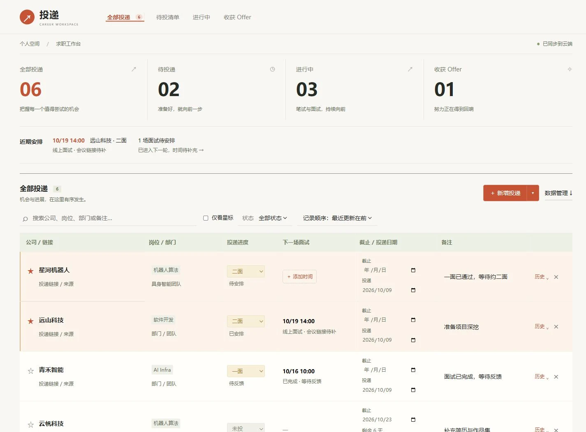
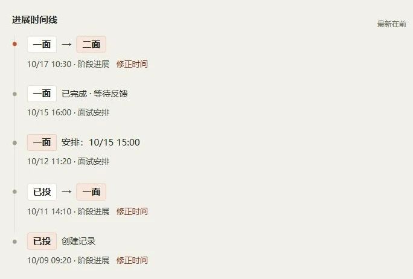

# 投递 · 求职工作台

把公司、岗位、投递进度和面试安排放在一张表里。直接填写、自动保存，给每一步进展留下一条时间线。

基于 **Cloudflare Workers + Hono + D1**，使用原生 HTML / CSS / JavaScript，适合个人自用和自行部署。



## 能做什么

| 功能 | 使用方式 |
| --- | --- |
| 表格直接填写 | 新增即出现空白行，填写公司、岗位、部门、链接、日期和备注，自动保存 |
| 批量录入公司 | 每行一个公司名，一次最多 100 家；检查输入重复、已有记录和回收站同名记录 |
| 投递进度 | 支持未投、已投、测评、笔试、一面、二面、三面、OC、已挂 |
| 独立面试安排 | 先进入下一轮，再补充面试日期、时间、会议链接或地点；支持改期与标记完成 |
| 状态时间线 | 记录状态变更、面试安排和完成；可修正实际反馈时间，保留系统记录时间 |
| 近期安排 | 首页展示已确定的面试安排和待安排面试；已过时间不会自动判定面试完成 |
| 星标与筛选 | 重点公司高亮，支持仅看星标；可按状态、关键词和排序查找 |
| 回收站 | 删除后可立即撤销，也可从回收站恢复，保留星标、面试安排与历史 |
| 云端与本地保存 | 云端同步、断网暂存、失败重试；也可以选择只在当前浏览器使用 |
| 备份与导出 | 完整 JSON 备份恢复、CSV 导出；兼容早期 JSON 备份 |

默认按**最近新增或编辑时间，从新到旧**排序；连续填写表格时保持行位置，离开表格后再排序。点星标不改变记录编辑时间。

### 一面通过了，但二面还没约？

**阶段反馈和面试日期分别记录：**

1. 收到一面通过反馈，把状态改成「二面」，显示「待安排」。
2. 约好时间后，填写二面的日期、时间和会议地点。
3. 面试结束后，点击「标记已完成」，显示「待反馈」。
4. 收到下一轮反馈，再更新阶段；原来的面试记录保留在时间线中。

快速连续操作和断网期间的进展会排队保存，避免只留下最后一次状态。



## 先在本机试用

需要 **Node.js 24 或更高版本**。

```sh
git clone https://github.com/cola1917/qiuzhao-tracker-cf.git
cd qiuzhao-tracker-cf
npm ci
npm run preview
```

打开 <http://127.0.0.1:8790>。预览使用独立的内存 SQLite 和虚构公司记录，不连接线上 D1，重启后恢复初始示例数据。

页面采用暖白和陶土橙配色，支持窄屏布局；表格列较多时可以左右滑动。

## 部署到自己的 Cloudflare

### 1. 创建数据库

```sh
npx wrangler login
npm run db:create
```

把创建结果中的数据库名称和 ID 填入 `wrangler.toml`：

```toml
[[d1_databases]]
binding = "DB"
database_name = "qiuzhao-tracker-db"
database_id = "替换为你自己的数据库 ID"
```

仓库中的数据库 ID 属于原项目，请使用你自己创建的数据库。若更改数据库名称，也要同步修改 `package.json` 和 GitHub Actions 中的数据库命令。

> `0002_import_data.sql` 包含早期初始化数据。新部署前请检查是否保留这些初始记录；本机演示使用的虚构数据由预览脚本单独提供。

### 2. 初始化与本地开发

```sh
npm run db:migrate:local
npm run dev
```

Wrangler 会显示本机访问地址。浏览器本地模式可在「数据管理 → 仅在此浏览器使用」中开启，其数据只保存在当前浏览器。

### 3. 配置访问保护并发布

本应用沿用 **Cloudflare Access / Zero Trust** 验证，不额外设置应用访问密钥。部署时需要自行配置访问策略，覆盖站点及 `/api/*` 路由。

```sh
npm run db:migrate:remote
npm run deploy
```

### 4. 使用 GitHub Actions 自动部署

在仓库 Settings → Secrets and variables → Actions 中添加：

- `CLOUDFLARE_API_TOKEN`
- `CLOUDFLARE_ACCOUNT_ID`

推送到 `main` 后，工作流依次执行安装依赖、类型检查、回归测试、构建、远程数据库迁移和 Worker 发布。部署串行执行，避免并行迁移。

不需要配置应用 `ACCESS_TOKEN`。

## 已有项目升级

升级前先在「数据管理 → 备份 JSON」中导出完整备份，再应用迁移并发布代码。

| 迁移 | 用途 |
| --- | --- |
| `0001_init.sql` | 基础表结构 |
| `0002_import_data.sql` | 早期初始化数据，不覆盖已有记录 |
| `0003_sync.sql` | 记录排序、同步版本与写入标记 |
| `0004_workbench.sql` | 星标、回收站、面试安排与独立历史表 |

新功能沿用现有 D1，无需新建库。历史功能启用时，只以当时的状态建立起点，不推测过去的面试日期或反馈过程。

## 保存、冲突与备份

- 公司和岗位在同一事务中保存，使用 `revision` 防止多设备互相覆盖。
- 遇到版本冲突时，保留本机未同步修改；先导出备份，再重新载入并按需恢复。
- 状态操作与记录在同一事务中保存，成功后只移除本次已确认的待同步操作。
- 删除移入回收站，不自动清空；恢复时保留投递信息与历史。
- 云端完整 JSON 备份包含正常投递、回收站、星标、面试安排和全部历史。
- 恢复备份会替换当前正常列表；被替换的原记录保留在回收站。
- 本地模式只使用当前浏览器存储，建议定期导出 JSON。

这是一套共享数据，**没有按用户隔离的独立空间**。适合个人使用或明确共享同一套数据的场景。浏览器备份未加密。

## 验证

```sh
npm run check   # TypeScript + 独立 SQLite 回归测试
npm run build   # Wrangler dry-run，不发布
```

测试不使用真实线上数据库，覆盖版本冲突、事务回滚、快速连续操作、时间线、面试安排、回收站、备份与批量录入。

## API 与数据约定

API 使用现有 Cloudflare Access 会话，响应设置 `Cache-Control: no-store`。

| 接口 | 用途 |
| --- | --- |
| `GET /api/data` | 返回 v3 快照：`revision`、`roles`、`companies`、`trash` |
| `PUT /api/data` | 按当前版本保存快照；版本过期返回 `409` |
| `GET /api/history/:id` | 按需加载单条投递的历史 |
| `GET /api/backup` | 获取包含全部历史的完整备份 |
| `PUT /api/backup` | 显式恢复完整备份 |
| `GET /api/roles` | 获取岗位与版本 |
| `POST /api/roles` | 以 `{ name, revision }` 新增岗位 |
| `DELETE /api/roles/:name` | 携带 `If-Match: <revision>` 移除岗位及当前投递关联 |

`updatedAt` 为记录编辑时间的毫秒时间戳，`starred` 为星标，`deletedAt` 为删除时间。`interview` 包含 `phase`（`pending` / `scheduled` / `feedback`）、UTC ISO 格式的 `at` 和 `location`；页面按浏览器本地时区展示和填写。

`activity` 保存待同步的进展操作；`historyEdits` 修正阶段事件的实际反馈时间。普通自动保存不传输全部历史。

最多 2000 条正常投递、2000 条回收站记录、200 个岗位；常规快照上限 1 MB（UTF-8）。完整备份中的历史最多 20000 条、8 MB。

## 项目结构

```text
public/                  页面、样式与交互
src/worker.ts            Hono API、数据校验、同步与历史事务
migrations/              D1 数据迁移
tests/                   独立 SQLite 与前端逻辑回归测试
scripts/preview.mjs       隔离的本机示例预览
.github/workflows/        自动验证与部署
docs/images/             使用虚构数据的功能截图
```

技术参考：[Cloudflare D1 batch](https://developers.cloudflare.com/d1/worker-api/d1-database/)、[Workers Static Assets](https://developers.cloudflare.com/workers/static-assets/)、[Cloudflare Access](https://developers.cloudflare.com/cloudflare-one/access-controls/)。
