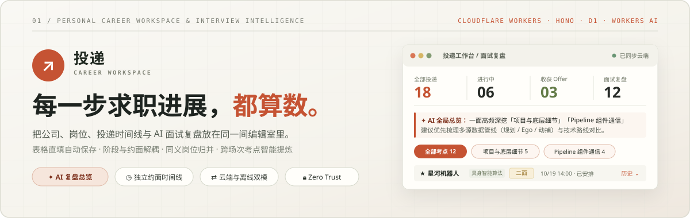
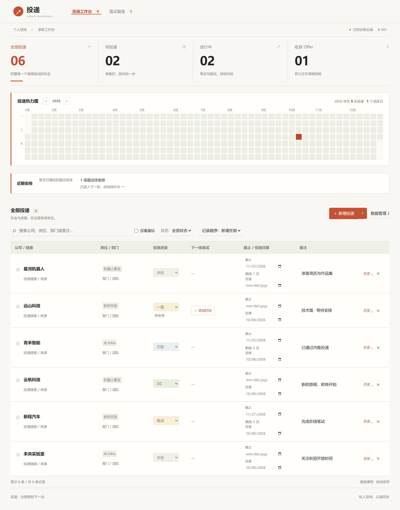
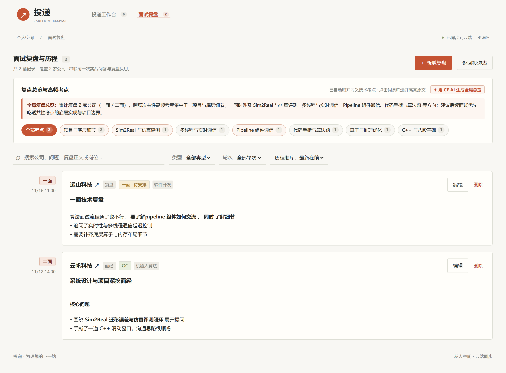
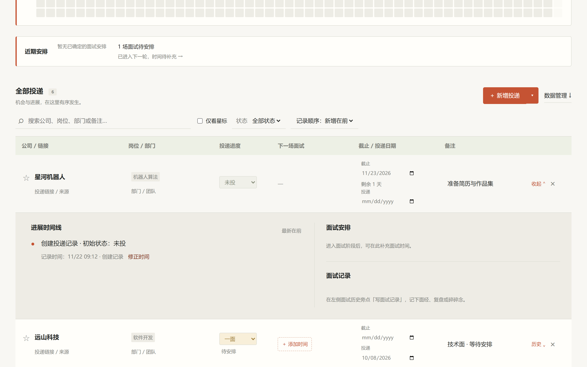
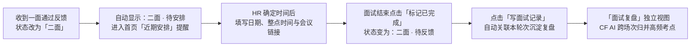

<div align="center">



<br />

# 投递 · 求职工作台 (Qiuzhao Tracker)

**把公司、岗位、投递时间线与 AI 面试复盘放在同一间编辑室里。**<br />
直接填写、自动保存、阶段与约面解耦，让秋招与日常求职的每一步进展都有迹可循。

[](https://workers.cloudflare.com/)
[](https://developers.cloudflare.com/d1/)
[](https://developers.cloudflare.com/workers-ai/)
[](https://hono.dev/)
[](#项目结构)
[](#3-配置访问保护并发布)
[](#先在本机试用)

[**✦ 核心特性**](#-核心特性) · [**🖼 界面预览**](#-界面预览) · [**🔄 进展与复盘工作流**](#-阶段进展与面试复盘工作流) · [**🚀 本机极速试用**](#-先在本机试用) · [**☁️ 部署到 Cloudflare**](#️-部署到自己的-cloudflare) · [**🔌 API 与数据约定**](#-api-与数据约定)

</div>

---

## ✦ 核心特性

<table>
  <tr>
    <td width="50%" valign="top">
      <h3>📋 表格直填与智能批量录入</h3>
      <ul>
        <li><b>零弹窗行内编辑</b>：新增即出现空白行，直接填写公司、岗位、部门、链接、截止/投递日期与备注，500ms 防抖自动保存。</li>
        <li><b>百企批量粘贴</b>：一次最多粘贴 100 家公司，自动去重并识别「已在列表中」或「已在回收站中」的同名记录。</li>
        <li><b>同义岗位自动归并</b>：内置岗位语义别名映射（<code>src/role-aliases.ts</code>），搜索与常用岗位分组展示，告别重复冗余标签。</li>
      </ul>
    </td>
    <td width="50%" valign="top">
      <h3>◷ 阶段反馈与面试安排解耦</h3>
      <ul>
        <li><b>9 大标准进度</b>：支持 <code>未投 → 已投 → 测评 → 笔试 → 一面 → 二面 → 三面 → OC / 已挂</code> 全周期流转。</li>
        <li><b>三态约面流转</b>：进入面试轮次后独立流转 <code>待安排 → 已安排（整点时间 + 会议链接） → 待反馈</code>。</li>
        <li><b>可追溯进展时间线</b>：完整记录每一次阶段推进、约面、改期、取消与完成，支持单独修正实际收到反馈的时间。</li>
      </ul>
    </td>
  </tr>
  <tr>
    <td width="50%" valign="top">
      <h3>🧠 独立面试复盘与 AI 考点归并</h3>
      <ul>
        <li><b>双视图无缝切换</b>：在「投递工作台」随手记下复盘，在独立「面试复盘」视图按时间轴纵向回顾成长历程。</li>
        <li><b>CF Workers AI 全局总览</b>：内置绑定 <code>@cf/zai-org/glm-4.7-flash</code>（免配外部 API Key），跨场次提炼全局复盘总览与备考建议。</li>
        <li><b>同义考点聚类与联动高亮</b>：自动将相近表达（如 <code>pipeline</code> / <code>组件如何交流</code>）归并为标准考点胶囊，点击即可跨公司筛选并在正文中高亮原文。</li>
      </ul>
    </td>
    <td width="50%" valign="top">
      <h3>🛡️ 乐观锁防冲突与双模存储</h3>
      <ul>
        <li><b>多端版本保护</b>：基于 <code>revision</code> 与 D1 事务门控（<code>write_token</code>）原子写入，防止多设备静默覆盖。</li>
        <li><b>断网暂存与一键恢复</b>：离线或版本冲突时自动保存在本地草稿，支持一键「保留本机修改并同步」或切换「用云端最新数据」。</li>
        <li><b>完整备份与回收站</b>：支持软删除撤销、回收站恢复（保留星标与历史）、完整 JSON 备份导入/导出及 CSV 导出。</li>
      </ul>
    </td>
  </tr>
  <tr>
    <td width="50%" valign="top">
      <h3>📈 投递热力图与漏斗进度</h3>
      <ul>
        <li><b>投稿节奏可视化</b>：GitHub 风格热力图按天汇总近 26 周的投递量，活跃日与投递总数一眼可见，并记录每一次「撒网」的节奏。</li>
        <li><b>阶段漏斗条</b>：把「待投 → 已投 → 笔面 → Offer → 已结束」做成一条彩色占比带，快速看清机会卡在哪个环节。</li>
      </ul>
    </td>
    <td width="50%" valign="top">
      <h3>🎨 编辑室主题与完整深色模式</h3>
      <ul>
        <li><b>暖白 × 陶土橙</b>：全站统一 Editorial 编辑室视觉，衬线标题、期号元数据与细分隔线，克制而有质感。</li>
        <li><b>真正的深色主题</b>：顶栏一键切换深浅色，所有颜色均由 CSS 变量驱动；切换时同步更新浏览器主题色，夜间使用更舒适。</li>
      </ul>
    </td>
  </tr>
</table>

---

## 🖼 界面预览

### 1. 投递工作台主视图（Editorial UI）

采用暖白（`#f8f7f3`）与陶土橙（`#c55333`）编辑室风格配色。默认按**固定记录顺序（新增在前）**展示，编辑、加星标与刷新均不打乱既有行位置；顶部统计卡片直接筛选全部、待投、进行中与 Offer。

<div align="center">
  
</div>

### 2. 独立「面试复盘与历程」视图（AI 全局总览 + 高频考点筛选）

汇总所有公司的面经、复盘与碎碎念。顶部由 **本地语义聚类 + Cloudflare Workers AI** 生成跨场次全局复盘总览与高频考点词条，点击任意考点即可过滤下方复盘卡片并高亮命中的原文片段，支持原地展开 Markdown 编辑器或删除记录。

<div align="center">
  
</div>

### 3. 行内进展时间线与独立约面面板

点击任意公司右侧的 `历史 ⌄`，即可在行内展开该公司的完整进展时间线、补充或修改面试时间与飞书/腾讯会议链接，并直接关联具体轮次撰写面试复盘。

<div align="center">
  
</div>

---

## 🔄 阶段进展与面试复盘工作流

> **痛点场景：一面通过了，但二面时间还没约定？**  
> 在传统表格里，你要么不敢改状态，要么改了状态却丢了一面时间和面经。本项目将**「阶段反馈」**、**「面试排期」**与**「面试复盘」**三者彻底解耦：



---

## 🚀 先在本机试用

需要 **Node.js 24 或更高版本**（使用 Node.js 内置 `node:sqlite` 运行本地内存数据库，零外部依赖）。

```sh
git clone https://github.com/cola1917/qiuzhao-tracker-cf.git
cd qiuzhao-tracker-cf
npm ci
npm run preview
```

浏览器打开 **<http://127.0.0.1:8790>** 即可体验：
- 预览环境使用**独立的内存 SQLite** 与虚构示例公司/复盘记录，不连接线上 D1，重启后自动恢复初始示例状态。
- 支持窄屏自适应与移动端横向滑动浏览。

---

## ☁️ 部署到自己的 Cloudflare

本应用基于 **Cloudflare Workers + D1 + Workers AI + Static Assets**，个人日常使用在 Cloudflare Free 计划免费额度内即可零成本运行。

### 1. 登录并创建 D1 数据库

```sh
npx wrangler login
npm run db:create
```

将终端输出的数据库名称与 `database_id` 填入 `wrangler.toml`：

```toml
[[d1_databases]]
binding = "DB"
database_name = "qiuzhao-tracker-db"
database_id = "替换为你自己的数据库 ID"

[ai]
binding = "AI"
```

> **提示**：仓库中的 `database_id` 属于原项目，部署前请替换为你自己创建的 D1 数据库 ID。若修改了 `database_name`，请同步更新 `package.json` 与 `.github/workflows/` 中的迁移命令。

### 2. 本地开发与数据库迁移

```sh
npm run db:migrate:local
npm run dev
```

Wrangler 会启动本机开发服务器。若不希望连接云端，也可随时在页面右上角「**数据管理 → 仅在此浏览器使用**」开启纯本地浏览器存储模式。

### 3. 配置访问保护并发布上线

本项目采用 **Cloudflare Access (Zero Trust)** 在边缘层统一验证身份，不在前端代码或本地存储中保存应用密码。请在 Cloudflare Zero Trust 控制台中为你的域名（含站点根路径及 `/api/*`）配置访问策略（如个人邮箱 OTP 或 GitHub OAuth）：

```sh
npm run db:migrate:remote
npm run deploy
```

### 4. 配置面试邮件提醒（可选）

项目内置 **Cloudflare Cron 定时任务**（`wrangler.toml` 中每天 UTC 00:00，即北京时间 08:00），会自动扫描未来 48 小时内已确定时间的面试，通过 **Resend** 发一封提醒邮件。免费层每月 3000 封，个人使用完全够。

1. 在 [Resend](https://resend.com) 注册并创建一个 API Key。
2. 用 Wrangler 配置密钥（不会写进代码或 Git）：

```sh
npx wrangler secret put RESEND_API_KEY   # 粘贴 Resend API Key
npx wrangler secret put NOTIFY_EMAIL     # 收件邮箱（你自己的邮箱）
```

3. 重新部署即可生效：

```sh
npm run db:migrate:remote   # 首次需创建 interview_reminders 去重表
npm run deploy
```

> 若某个面试通知已经发过，系统会记录去重，不会重复发送；未配置密钥时该功能自动静默跳过，不影响其它功能。如需自定义发件人（需 Resend 验证域名），可再设置 `NOTIFY_FROM`。

### 5. 配置 GitHub Actions 自动部署（可选）

在 GitHub 仓库 `Settings → Secrets and variables → Actions` 中添加以下两个 Secret：

- `CLOUDFLARE_API_TOKEN`
- `CLOUDFLARE_ACCOUNT_ID`

推送到 `main` 分支后，工作流会自动串行执行：`npm ci` → `typecheck` → `回归测试` → `build 预检` → `D1 远程迁移` → `Worker 发布`。

<details>
<summary><b>📦 已有项目升级与数据库迁移说明（点击展开）</b></summary>

<br />

升级前建议先在页面右上角「**数据管理 → 备份 JSON**」导出完整备份，随后执行 `npm run db:migrate:remote && npm run deploy`。所有新特性均沿用现有 D1 数据库，无需删库重建：

| 迁移文件 | 用途说明 |
| --- | --- |
| `0001_init.sql` | 基础 `companies` 与 `roles` 表结构 |
| `0002_import_data.sql` | 默认基础岗位种子数据（使用 `INSERT OR IGNORE`，绝不覆盖已有记录） |
| `0003_sync.sql` | 记录固定排序（`position`）、乐观锁版本号（`revision`）与事务写入令牌（`write_token`） |
| `0004_workbench.sql` | 星标（`starred`）、回收站（`deleted_at`）、面试安排（`interview`）与独立历史表（`company_history`） |
| `0005_interview_notes.sql` | 独立面试笔记表（`interview_notes`），支持绑定具体面试事件锚点 |
| `0006_merge_role_names.sql` | 同义岗位标准名称归并，自动迁移正常投递与回收站中的岗位关联 |
| `0007_notifications.sql` | 面试邮件提醒去重表（`interview_reminders`），防止 Cron 重复发送 |

</details>

---

## 🧪 测试与构建验证

```sh
npm run check      # TypeScript 类型检查 + 55 项独立 SQLite/前端回归测试
npm run test:e2e   # Playwright 端到端测试（6 项，真实浏览器；首次需 npx playwright install chromium）
npm run build      # Wrangler 生产打包预检 (--dry-run)，输出至 dist/
```

测试套件完全基于隔离的内存 SQLite 与 VM 沙箱运行，不触碰线上数据库；E2E 则通过 `scripts/preview.mjs` 的独立预览服务驱动真实浏览器，完整覆盖：
- 乐观锁版本冲突（`409`）与离线草稿恢复
- D1 批量事务失败自动回滚（`BEGIN ... ROLLBACK`）
- 快速连续切换状态与约面的操作队列（`activity`）保真
- 面试改期、取消、完成与复盘笔记锚点稳定性
- 面试复盘删除同步、本地语义考点聚类与 Cloudflare Workers AI（`@cf/zai-org/glm-4.7-flash`）接口规约

---

## 🔌 API 与数据约定

所有 `/api/*` 路由均设置 `Cache-Control: no-store`，复用 Cloudflare Access 会话。

| 接口路由 | 方法 | 用途说明 |
| --- | --- | --- |
| `/api/data` | `GET` | 获取 v3 工作台快照：`revision`、`roles`、`roleAliases`、`companies`、`trash`、`notes` |
| `/api/data` | `PUT` | 基于当前 `revision` 原子保存快照、待同步操作队列（`activity`）与笔记变更；版本过期返回 `409` |
| `/api/history/:id` | `GET` | 按需加载指定公司的完整进展时间线（`company_history`） |
| `/api/ai/topics` | `POST` | 调用 Cloudflare Workers AI（`@cf/zai-org/glm-4.7-flash`）生成跨篇全局复盘总览与同义归并考点 |
| `/api/backup` | `GET` | 导出包含全部公司、回收站、面试笔记与完整时间线历史的 JSON 备份 |
| `/api/backup` | `PUT` | 显式恢复完整备份（被替换的原有记录自动归档至回收站，不丢失数据） |
| `/api/roles` | `GET` / `POST` | 查询岗位列表，或携带 `{ name, revision }` 新增岗位 |
| `/api/roles/:name` | `DELETE` | 携带 `If-Match: <revision>` 原子移除指定岗位并清理当前投递关联 |

<details>
<summary><b>📐 数据配额与安全边界（点击展开）</b></summary>

<br />

- **容量上限**：最多保存 `2,000` 条正常投递、`2,000` 条回收站记录、`200` 个岗位（单次快照上限 `1 MB` UTF-8）。
- **面试笔记上限**：最多保存 `1,000` 篇面试复盘笔记（单篇标题 `200` 字、Markdown 正文 `20,000` 字，合计上限 `1 MB`）。
- **历史备份上限**：完整备份中的时间线历史最多 `20,000` 条（上限 `8 MB`）。
- **XSS 与注入防护**：前后端双重校验 ID、ISO 日期与枚举字段；Markdown 预览先转义全部 HTML 实体，仅允许 `http(s)://` 协议链接；CSV 导出自动转义公式注入前缀（`=`, `+`, `-`, `@`）。

</details>

---

## 📂 项目结构

```text
qiuzhao-tracker-cf/
├── public/                  # 前端静态资源（原生 HTML / Editorial CSS / ES 脚本）
│   ├── index.html           # 单页双视图骨架（投递工作台 + 面试复盘）
│   ├── app.js               # 核心状态管理、乐观锁同步、搜索筛选与导入导出
│   ├── workbench.js         # 约面流转、进展时间线、批量录入与回收站
│   ├── interview-notes.js   # 面试复盘编辑器、独立复盘时间轴、本地与 CF AI 考点聚类
│   ├── role-picker.js       # 岗位分组搜索选择器与同义词解析
│   ├── app.css              # 基础组件样式与深浅色变量
│   ├── editorial.css        # 暖白与陶土橙编辑室主题样式
│   └── workbench.css        # 时间线、约面表单与独立复盘视图样式
├── src/
│   ├── worker.ts            # Hono API、数据快照校验、D1 事务同步与 Workers AI 路由
│   └── role-aliases.ts      # 岗位同义名称归并映射表
├── tests/                   # Node.js 测试套件（API、工作台事务、通知与前端沙箱回归测试）
├── e2e/                     # Playwright 端到端测试（真实浏览器关键流程）
├── scripts/
│   ├── preview.mjs          # 零配置的本地内存 SQLite 隔离预览服务
│   ├── screenshots.mjs      # 从预览服务生成 README 截图
│   └── style-preview.mjs    # 主题样式预览
├── migrations/              # D1 SQLite 数据库增量迁移脚本 (0001 ~ 0007)
├── playwright.config.js     # Playwright E2E 配置
└── docs/images/             # README 横幅与功能预览图
```
